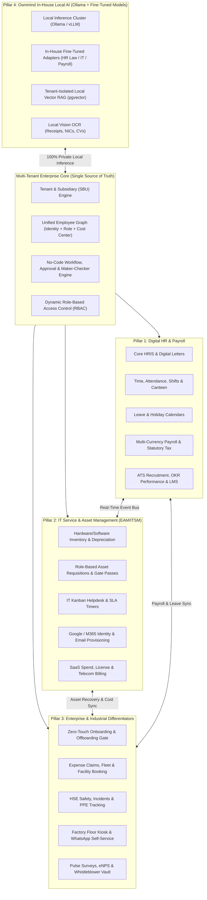
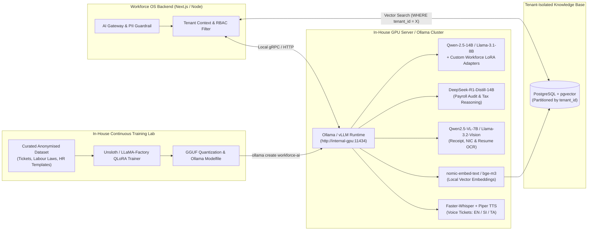

# Crewlane

**A Multi-Tenant Unified Workforce, HR, Payroll & IT Service/Asset Management OS — Powered by Ownmind In-House Local AI**

> **Strategic Vision:** Build a multi-tenant B2B SaaS and on-premise enterprise platform — a *"Rippling for emerging and global enterprises"* — that unifies **Digital HR & Payroll** with **Enterprise Asset Management & IT Service Management (EAM/ITSM)**, powered by **Ownmind**, a 100% sovereign in-house local AI engine (Ollama + custom fine-tuned models). Any organisation (from a 50-person tech company to a 10,000+ employee manufacturing conglomerate, bank, hospital, or government body) can automate its entire **Hire-to-Retire** lifecycle and run AI across Payroll, HR, and IT with **zero external API token costs and 100% data privacy**.

---

## Project at a Glance

| Attribute | Summary |
| :--- | :--- |
| **Project** | Crewlane |
| **What It Is** | Cloud and on-premise software unifying HR, payroll, IT service desk, and asset management with built-in private AI |
| **Who It Is For** | Organisations from ~50 to 10,000+ employees: technology companies, manufacturers, banks, hospitals, conglomerates, and government bodies |
| **Core Promise** | One unified system for the full Hire-to-Retire lifecycle, with zero external AI costs and 100% data privacy |
| **How It Is Sold** | Multi-tenant cloud subscription (per employee per month) and an on-premise enterprise licence (*Ownmind Enterprise Appliance*) |
| **Build Plan** | Four phases over 28 weeks |

---

## 1. The Problem & Market Opportunity

In almost every organisation today, **HR**, **IT**, **Finance**, and **Operations** work in disconnected silos:

- **HR** uses an HCM system (such as MiHCM, BambooHR, or spreadsheets) for employee records, attendance, leave, and payroll.
- **IT** uses a separate ticketing and asset tool for laptops, corporate email accounts, software licences, and support SLAs.
- **Finance** tracks asset depreciation, vendor SaaS bills, expense claims, and payroll payouts in another system.
- **Enterprise AI Adoption Is Blocked by Privacy:** Banks, conglomerates, and manufacturers want AI for payroll auditing, HR policy chat, CV screening, and IT helpdesk triage — but refuse to send salaries, national ID or passport numbers, medical certificates, and financial data to external cloud AI APIs (OpenAI, Google Gemini, Anthropic).

### What Breaks When HR and IT Are Disconnected?

- **Broken Onboarding:** HR hires a candidate, then manually emails IT to create an email account and provision a laptop. Day-1 productivity is lost.
- **Dangerous Offboarding:** HR marks an employee as resigned, but IT is not alerted in real time — leaving corporate emails active, software licences billed, and laptops unrecovered before Final Settlement (gratuity / last pay) is released.
- **Blind Routing:** An IT agent or approving Head of Department goes on annual leave in the HR system, yet the helpdesk Kanban board and approval workflows keep assigning urgent SLA tickets to them.
- **Hardcoded Limits:** Single-company portals require developer code changes to add a new Strategic Business Unit (SBU), adjust an approval workflow, or configure new country tax tables.

---

## 2. Product Architecture: Four Pillars on One Foundation

Every module sits on one shared foundation: a single employee record, dynamic organisation tree, no-code workflow engine, and granular access control. The pillars connect through a real-time event bus so one department's action automatically triggers work in another.

| Layer | Focus | What It Covers |
| :--- | :--- | :--- |
| **Foundation** | Multi-Tenant Core | Organisation & SBU engine, unified employee record, no-code workflow & maker-checker approval engine, granular RBAC |
| **Pillar 1** | Digital HR & Payroll | Core HRIS & digital letters, time & attendance, shifts, leave, multi-currency payroll & statutory tax, ATS recruitment, OKRs & LMS |
| **Pillar 2** | IT Service & Asset Management (EAM/ITSM) | Asset inventory & depreciation, role-based asset requisitions & procurement, Kanban helpdesk with SLA timers, Google Workspace / M365 provisioning, SaaS & telecom billing |
| **Pillar 3** | Enterprise & Industrial Features | Zero-touch onboarding & offboarding gate, expense claims, fleet & facility booking, HSE & PPE tracking, factory floor kiosk, pulse surveys & whistleblower vault |
| **Pillar 4** | Ownmind In-House Local AI | Private AI engine on local GPU servers or client data centres: HR/IT co-pilot, payroll auditor, local OCR, tenant-isolated RAG, and multilingual voice |



---

## 3. Core Modules Breakdown (Pillars 1 & 2)

### Pillar 1: Digital HR, Workforce & Payroll

1. **Core HRIS & Employee Lifecycle Management**
   - Centralised employee profiles (personal, emergency contacts, dependents, split-pay banking, passport/visa/NIC tracking with expiry alerts, qualifications, prior employment).
   - Visual interactive org chart supporting direct reporting managers, functional HODs, and dotted-line matrix managers.
   - Career lifecycle timeline: probation & confirmation workflows, promotions, inter-SBU transfers, salary revisions, and disciplinary/grievance logs.
   - **Document Generator & e-Signature Vault:** Auto-generate appointment, confirmation, increment, and warning letters and service certificates with dynamic placeholders and digital signatures.

2. **Time, Attendance & Shift Roster Engine**
   - **Multi-Modal Clock-In:** Biometric hardware webhook/ADMS bridge (ZKTeco, Hikvision, Suprema), mobile GPS geofenced clock-in with selfie verification, and IP-restricted web check-in.
   - **Shift & Roster Planner:** Fixed, rotating, split, and 24/7 factory shifts, automated overtime (OT / Double OT / Holiday OT) calculation, late grace periods, short-leave deductions, and lieu-leave generation.
   - **Attendance Regularization:** Self-service missed-punch and outdoor-duty requests with manager approval.

3. **Smart Leave & Absence Management**
   - Configurable leave policies per employee grade and contract type (Annual, Casual, Medical, Maternity, Paternity, Study, No-Pay, Lieu).
   - Automated pro-rata accrual rules, carry-forward limits, leave encashment formulas, and a team conflict calendar for managers.

4. **Enterprise Payroll, Loans & Statutory Compliance**
   - Configurable pay elements with a custom formula builder and one-click attendance-to-payroll sync (OT, No-Pay days, late deductions, meal/canteen deductions, night-shift allowances).
   - Staff loans and salary advances with automated monthly EMI deductions and real-time principal balances.
   - **Statutory & Tax Compliance Packs:** Automated calculation and statutory filings (Sri Lanka EPF C-Form, ETF, APIT, gratuity accrual & payout; extensible to UAE WPS, Singapore CPF, UK PAYE, and others).
   - Bank bulk payment files (SLIPS / CEFT / CSV), month-over-month variance reports, ERP General Ledger (GL) journal exports, and encrypted payslips.

5. **Recruitment (ATS), Performance (OKRs) & Learning (LMS)**
   - Branded career page, local AI resume ranking, interview scorecards, digital offer letters, and a **Pre-Boarding Portal** where candidates submit NIC, tax, and bank details prior to Day 1.
   - Goal/KPI/OKR tracking, mid-year and annual 360° appraisals, competency matrices, 9-box talent grid, PIP tracking, and direct linkage to increment/bonus proposals.
   - Internal training courses, video/quiz modules, mandatory compliance sign-offs, training budgets, and skills gap analysis.

### Pillar 2: Enterprise Asset, Identity & IT Service Management

1. **Role-Based Asset Requisitions & Procurement**
   - Multi-asset requests (hardware, software licences, peripherals, corporate mobile/SIMs, industrial/safety gear) with configurable multi-stage approvals.
   - **Procurement & PO Pipeline:** Convert out-of-stock requisitions into vendor RFQs, comparative quotations, Purchase Orders (POs), and Goods Received Notes (GRNs) that update inventory automatically.

2. **Full-Lifecycle Asset Inventory & Financial Depreciation**
   - QR code, barcode, and RFID label generation with mobile scanner lookup.
   - Complete custody chain (`Available` -> `Reserved` -> `Assigned` -> `Out on Gate Pass` -> `In Maintenance` -> `Retired/Disposed`) with digital handover/return forms and e-signatures.
   - Automated Straight-Line and Written-Down Value (WDV) depreciation schedules for Finance audits.

3. **IT Service Desk & Kanban Operations**
   - Omnichannel intake (Web Portal, Email-to-Ticket, Microsoft Teams, Slack, WhatsApp, Factory Kiosk).
   - Visual Kanban board + table views with live SLA countdown timers (auto-paused on `Pending User Confirmation` or outside tenant working hours/holidays), internal notes, watchers, CSAT ratings, and asset-linked incident histories.

4. **Identity & Access Management (IAM) Provisioning**
   - Direct API integrations with **Google Workspace** and **Microsoft 365 / Entra ID** to provision corporate email accounts, assign groups/OUs, enforce password resets, and revoke active sessions automatically.

5. **SaaS Subscription, Licence & Telecom Billing Monitor**
   - Seat assignment and utilisation tracking across software vendors, automated renewal reminders (30/14/7 days ahead), SBU cost allocation, invoice vault, and corporate mobile usage monitoring.

---

## 4. Key Enterprise & Industrial Differentiators (13 Capabilities)

1. **Zero-Touch "Hire-to-Retire" Orchestrator & Offboarding Gate:** Hiring triggers employee/payroll setup, email provisioning, role-based equipment requests, and Day-1 LMS training. Resignation triggers an IT & Facility clearance ticket for every assigned item, and **Payroll blocks Final Settlement / Gratuity** until all assets are returned and accounts revoked (with automatic recovery deductions for lost/damaged items).
2. **Leave-Aware Routing:** If an approving HOD or IT engineer is on approved leave or absent on biometric clock-in, pending approvals and urgent tickets automatically route to their designated Acting Officer.
3. **Canteen, Meal Subsidy & Staff Transport:** Biometric meal tracking calculates company subsidy vs. employee co-pay, syncs employee meal shares to monthly payroll, verifies caterer invoices, and manages shuttle routes/rosters.
4. **HSE Safety, Incidents & PPE Tracking:** Issue and replacement schedules for safety gear (boots, helmets, goggles, uniforms) with digital sign-offs, workplace incident/near-miss reporting, root-cause workflows, and ISO 45001 / OSHA audit readiness.
5. **Material & Asset Gate Passes:** Returnable and non-returnable digital gate passes linked to Asset IDs; security guards scan QR codes at the gate and IT/Admin receive alerts when returnable assets are overdue.
6. **Offline-First Factory Floor Kiosk (PWA):** Shared rugged tablets where workers without corporate emails or smartphones sign in by Employee QR Badge or Employee Number + PIN to view/print payslips, check OT, request leave, or log faults in **English, Sinhala, or Tamil**, syncing when connectivity returns.
7. **Local AI Expense Claims & Mileage:** Staff photograph a receipt; `Qwen2.5-VL` extracts merchant, date, line items, and total, flags duplicates, validates policy limits, and routes approved claims to petty cash or the next payslip.
8. **Lightweight Endpoint & MDM Discovery Agent:** Optional background agent (plus Intune / Google Endpoint sync) reports live hardware specs, disk/battery health, OS patch status, and installed software into EAM inventory.
9. **Facilities, Visitor & Fleet Management:** Meeting room and hot-desk booking, QR visitor passes with photo/NDA capture, and pool vehicle booking with odometer photo OCR and insurance/licence renewal alerts.
10. **Engagement, Pulse Surveys, eNPS & Whistleblower Vault:** Pulse check-ins, eNPS scoring, peer recognition ("Kudos"), and an end-to-end encrypted anonymous reporting vault with two-way ethics committee messaging.
11. **Telecom & Utility Bill Splitter:** Compares monthly corporate mobile/SIM bills against role caps and routes personal excess usage for one-click payroll deduction approval.
12. **WhatsApp & Microsoft Teams Bot:** Employees check leave balances, request payslips, or log IT/maintenance faults via text or voice note; managers approve requests with one tap.
13. **Maker-Checker Controls & Immutable Audit Trail:** Dual authorisation for high-risk actions (finalising payroll, exporting bank files, changing employee bank accounts, writing off assets) plus an append-only audit log (`who`, `tenant_id`, `ip_address`, `before_json`, `after_json`) for ISO 27001, SOC 2, and financial audits.

---

## 5. Multi-Tenant Scalability

| Capability | Single-Company Portal | Crewlane Multi-Tenant Platform |
| :--- | :--- | :--- |
| **Organisation Structure** | Fixed business units in code | **Dynamic Org Tree Builder:** Unlimited legal entities, SBUs, factories, branches, cost centres, and locations |
| **Domains & Email** | Hardcoded domain mapping | **Tenant Domain Registry:** Per-tenant domains and independent Google Workspace / Microsoft 365 OAuth credentials |
| **Approval Workflows** | Fixed `SBU -> Admin -> IT` flow | **No-Code Workflow Builder:** Conditional drag-and-drop chains (e.g., *"If asset cost > \$1,500, require Finance Director approval"*) |
| **Branding & White-Label** | Static logos and theme | **Per-Tenant & Per-Unit Branding:** Custom subdomains, logos, brand colours, PDF letterheads, and custom SMTP servers |
| **Access Control (RBAC)** | Fixed roles | **Granular Permission Matrix:** Custom roles scoped to Self, Direct Reports, Department, SBU, or Global |
| **Localisation & Compliance** | Single timezone & currency | **Multi-Country Engine:** Per-entity timezone, currency, workweek, public holidays, and pluggable statutory tax packs |
| **AI Privacy & Hosting** | Cloud-dependent or none | **Ownmind Local AI (Ollama):** Runs on central GPU servers or inside a client's air-gapped data centre with per-tenant isolation |

---

## 6. Ownmind In-House Local AI Architecture

Rather than wrapping external cloud LLM APIs — where confidential salary/ID data leaves the organisation and token costs scale against margins — Crewlane runs **Ownmind**, an in-house local AI engine orchestrated via **Ollama / vLLM** with **custom QLoRA fine-tuned adapters** and **per-tenant `pgvector` RAG**.



### Local Model Roster (Ollama)

| AI Capability | Local Model in Ollama | VRAM (4-bit) | Platform Responsibilities |
| :--- | :--- | :--- | :--- |
| **HR & IT Co-Pilot** | `qwen2.5:14b-instruct` or `llama3.1:8b-instruct` + **In-House LoRA** | ~6–10 GB | Tier-1 IT troubleshooting, HR policy Q&A, drafting letters, summarising tickets, natural-language report filters |
| **Payroll & Financial Auditor** | `deepseek-r1:14b` | ~9 GB | Step-by-step payroll run audits, salary/OT anomaly detection, tax formula checks, SBU budget forecasting |
| **Local Document OCR & Vision** | `qwen2.5-vl:7b` or `llama3.2-vision:11b` + `PaddleOCR` | ~6–8 GB | Zero-cloud OCR for expense receipts, NICs/passports, medical certificates, vendor invoices, and CVs |
| **Local Embeddings (RAG)** | `bge-m3` or `nomic-embed-text` | ~1.5 GB | Multilingual vector search (English, Sinhala, Tamil) across tenant handbooks, SOPs, and IT manuals |
| **Voice & Multilingual** | `Faster-Whisper` | ~2 GB | Voice-note transcription in Sinhala, Tamil, or English from WhatsApp or Factory Kiosks |

### In-House Training & Security Guardrails

1. **Curate Anonymised Data:** Historical IT ticket resolutions, country labour law rules (e.g., Shop & Office Employees Act, Wages Boards Ordinance, EPF/ETF/APIT), HR templates, and structured database-filter examples.
2. **QLoRA Fine-Tuning:** Train domain adapters (`workforce-hr`, `workforce-itsm`) in a few hours on a single 24 GB GPU using **Unsloth** or **LLaMA-Factory**.
3. **GGUF Export & Ollama Registration:** Quantise (`Q4_K_M` / `Q5_K_M`) and deploy with custom `Modelfile` guardrails (`ollama create workforce-ai -f ./Modelfile`).
4. **Continuous DPO Loop:** Anonymised human edits to AI drafts feed a monthly Direct Preference Optimization (DPO) pass.
5. **Strict Tenant Isolation:** Shared model weights learn only general skills; company-specific policies and records live strictly in **PostgreSQL `pgvector`** filtered by `tenant_id` and user RBAC scope prior to inference.

---

## 7. Recommended Technical Stack

| Layer | Stack | Purpose |
| :--- | :--- | :--- |
| **Frontend & API** | **Next.js (App Router, TypeScript)**, Tailwind CSS, Shadcn UI, PWA | Fast SSR, modular route groups (`(hr)`, `(it)`, `(payroll)`, `(kiosk)`, `(ess)`), and offline-ready factory kiosk PWA |
| **Database & Vector Store** | **PostgreSQL 16+** with Prisma / Drizzle ORM + **`pgvector`** | ACID transactions for payroll/inventory, Row-Level Security (RLS) for `tenant_id` isolation, and unified vector search |
| **AI Inference** | **Ollama** (dev / single GPU) & **vLLM** (high-concurrency prod) | OpenAI-compatible internal inference endpoint (`http://gpu-node:11434/v1`) |
| **AI Training** | **Unsloth**, **LLaMA-Factory**, Hugging Face PEFT | Fast QLoRA fine-tuning and GGUF export |
| **Workflow & Queues** | **BullMQ + Redis** (self-hosted) or **Inngest** | Monthly payroll batch runs, AI OCR/CV parsing jobs, SLA timers, and biometric sync |
| **Authentication & SSO** | **Better-Auth / Auth.js** | Email/password, Employee ID + PIN (kiosk), MFA, passkeys, and per-tenant SAML/OIDC SSO |
| **File & Document Storage** | **MinIO (Self-Hosted S3)** or Cloudflare R2 / AWS S3 | Tenant-partitioned encrypted buckets (`/{tenantId}/payslips/`, `/{tenantId}/handovers/`) |

---

## 8. Phased Implementation Roadmap (28 Weeks)

| Phase | Timeline | Key Deliverables |
| :--- | :--- | :--- |
| **Phase 1: Foundation, Core HR & Governance** | Weeks 1–6 | Multi-tenant PostgreSQL schema (`tenant_id` RLS), onboarding wizard, custom subdomains & white-labelling; dynamic org builder; RBAC, maker-checker engine, immutable audit logs & no-code workflow builder; Core HRIS directory, digital letter generator & pre-boarding portal |
| **Phase 2: EAM, ITSM Kanban & Automation** | Weeks 7–12 | Multi-tenant EAM/ITSM upgrade: QR/RFID inventory, depreciation, digital handovers & PO/GRN procurement; security QR gate passes; IT Kanban helpdesk with SLA calendars & leave-aware auto-delegation; Google Workspace & M365 provisioning; SaaS/telecom billing monitor; zero-touch onboarding & offboarding gate |
| **Phase 3: Time, Attendance, Leave & Payroll** | Weeks 13–20 | Shift & roster planner, mobile GPS/selfie clock-in, biometric device webhook bridge & canteen subsidy tracker; leave engine with accrual & conflict views; multi-currency payroll formula builder, one-click sync, loans, bank files (SLIPS/CEFT), statutory reports (EPF/ETF/APIT) & encrypted payslips; offline-first factory kiosk mode |
| **Phase 4: Ownmind AI, Talent & Facilities** | Weeks 21–28 | Ollama AI cluster + `pgvector` RAG chatbot; local vision OCR (`Qwen2.5-VL`) for receipts/NICs/CVs; `DeepSeek-R1` payroll auditor & flight-risk predictor; in-house QLoRA/DPO fine-tuning pipeline; ATS, OKR 360° appraisals & LMS; HSE/PPE, fleet/room/visitor management, whistleblower vault & WhatsApp/Teams bot |

---

## 9. Commercialisation & Deployment Models

1. **Multi-Tenant Cloud SaaS (Per Employee Per Month):** Hosted on central infrastructure with a shared GPU cluster running Ownmind AI:
   - *Core + People & Payroll Cloud* (MiHCM alternative)
   - *Core + IT, Asset & Gate Pass Cloud* (ITSM/EAM alternative)
   - *Workforce OS Enterprise Complete + Ownmind AI Bundle*
2. **On-Premise "Ownmind Enterprise Appliance" (Annual Licence):** Packaged via Docker / Kubernetes for deployment inside a client's own firewall — built for **banks, defence, healthcare, government, and large manufacturing groups** requiring 100% air-gapped data and local AI.

---

## 10. Getting Started & Repository Workflow

### Local Development

Install dependencies and run the Next.js development server:

```bash
npm install
npm run dev
```

Open [http://localhost:3000](http://localhost:3000) in your browser.

> **Windows PowerShell note:** If PowerShell execution policy restricts `.ps1` scripts, invoke `npm.cmd` (e.g. `npm.cmd run dev`, `npm.cmd run build`, `npm.cmd run lint`).

### Available Scripts

- `npm run dev` — Start the Next.js development server
- `npm run build` — Create an optimised production build
- `npm run start` — Start the production server
- `npm run lint` — Run ESLint (`eslint.config.mjs`)

### Branching & CI Rules

- **`main`** and **`dev`** are protected branches requiring pull requests with at least 1 approval and passing GitHub Actions CI checks (`build-and-lint`: `npm ci`, `npm run lint`, `npm run build`).
- Create feature/fix branches from `dev` and open a pull request using the repository's PR and Issue templates in `.github/`.
