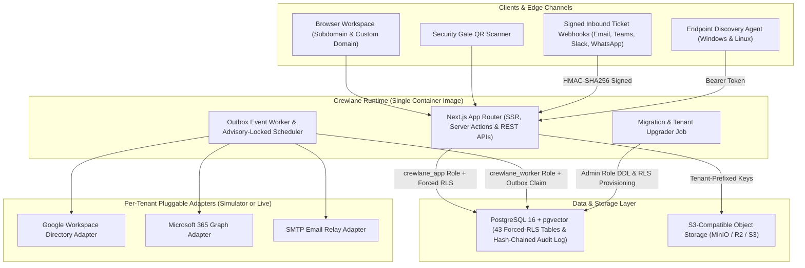
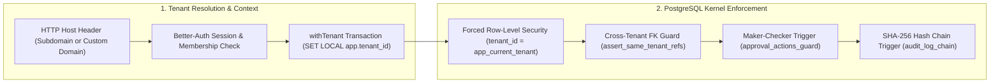
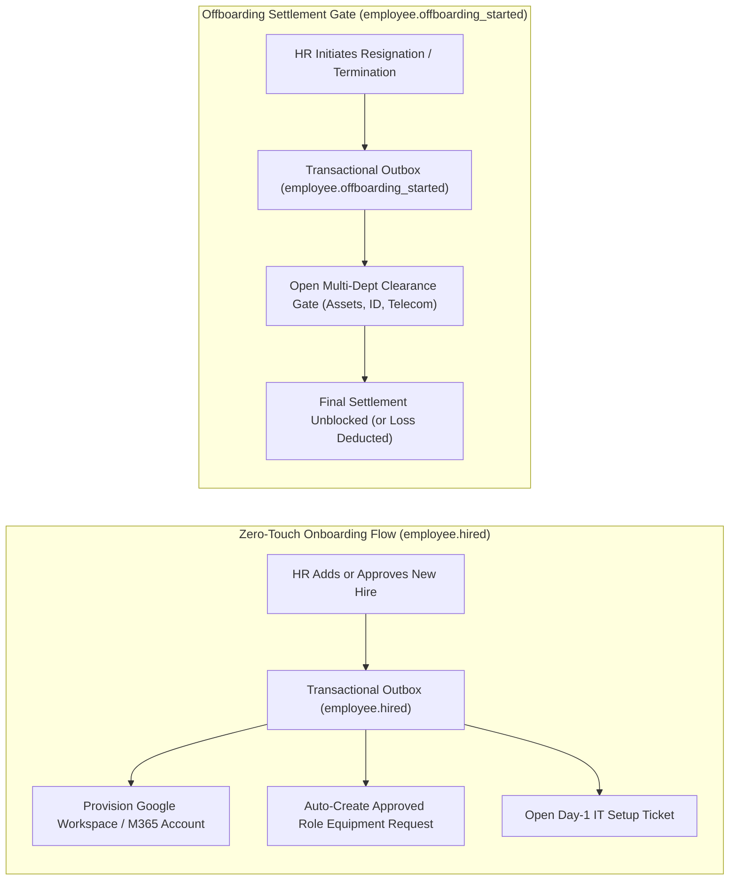

# Crewlane — Technical Architecture & Developer Reference (Phases 1 & 2)

This document provides the complete engineering specification for the **Crewlane Unified Workforce OS** implementation covering **Phase 1 (Multi-Tenant Foundation, Core HR & Governance)** and **Phase 2 (Enterprise Asset, Identity & IT Service Management + DevOps)**.

Related documentation:
- [`README.md`](../README.md) — Executive Project Brief, 4-Pillar Vision, Quick Start & Repository Workflow
- [`docs/FEATURES.md`](./FEATURES.md) — Product Feature Matrix & Implementation Status across Phases 1–4

---

## 1. High-Level System Architecture

Crewlane is architected as a modular monolith with an asynchronous transactional outbox worker, sharing a single container image across three runtime entrypoints (`web`, `worker`, and `migrate`).



---

## 2. Defense-in-Depth Multi-Tenancy & Database Security

Unlike conventional SaaS applications that rely solely on application-level `WHERE tenant_id = ?` filters, Crewlane enforces tenant isolation, maker-checker governance, and audit immutability directly inside PostgreSQL (`drizzle/0001_security.sql` and `drizzle/0003_phase2_security.sql`).



### 2.1 Non-Owner Runtime Roles
 migrations run under the administrative connection (`DATABASE_ADMIN_URL`) and provision two least-privilege runtime roles that **own no tables** and have `NOBYPASSRLS`:
- **`crewlane_app`** (`DATABASE_URL`): Used by the Next.js web server.
- **`crewlane_worker`** (`WORKER_DATABASE_URL`): Used by the background outbox worker and periodic scheduler.

### 2.2 Fail-Closed Forced Row-Level Security (RLS)
Every tenant-scoped table has `ENABLE ROW LEVEL SECURITY` and `FORCE ROW LEVEL SECURITY` with a unified policy:
```sql
CREATE POLICY tenant_isolation ON <table>
  USING (tenant_id = app_current_tenant())
  WITH CHECK (tenant_id = app_current_tenant());
```
- `app_current_tenant()` reads `current_setting('app.tenant_id', true)` and casts it to `uuid` (returning `NULL` if unset or empty).
- Because `NULL = tenant_id` evaluates to `NULL` (falsy in SQL `WHERE`/`USING`), **any query executed outside a tenant transaction returns zero rows and cannot insert or mutate data**.
- In the application layer, `withTenant(tenantId, fn)` (`src/db/tenant.ts`) opens a database transaction, executes `SELECT set_config('app.tenant_id', $1, true)`, and runs all queries inside that transaction scope.

### 2.3 Cross-Tenant Reference Guard Trigger (`assert_same_tenant_refs`)
Standard PostgreSQL foreign keys check primary key existence across the entire table regardless of RLS. To prevent a tenant from referencing another tenant's UUIDs in foreign-key columns, `assert_same_tenant_refs()` attaches `BEFORE INSERT OR UPDATE` triggers across all tenant tables and verifies that every referenced parent row belongs to the exact same `tenant_id`.

### 2.4 Database-Enforced Maker-Checker (`approval_actions_guard`)
Dual-control governance is enforced at the database level via `approval_actions_guard()` (`drizzle/0001_security.sql`):
1. **Self-approval prevention:** Raises `maker-checker violation: requester cannot act on own approval request` if `requested_by = actor_user_id`.
2. **Independent multi-step verification:** Raises `maker-checker violation: same officer cannot approve multiple steps` if the same user attempts to approve more than one step on a multi-step approval chain.

### 2.5 Tamper-Evident SHA-256 Hash-Chained Audit Log
- `REVOKE UPDATE, DELETE, TRUNCATE ON TABLE audit_log FROM PUBLIC, crewlane_app, crewlane_worker;`
- A `BEFORE UPDATE OR DELETE` trigger (`audit_log_block_mutation`) unconditionally blocks mutations even from superusers/table owners.
- On every `INSERT`, `audit_log_chain()` acquires a transaction-scoped per-tenant advisory lock (`pg_advisory_xact_lock(hashtext('audit:' || NEW.tenant_id::text))`), assigns a strictly monotonic per-tenant `seq`, links `prev_hash` from row `seq - 1` (or `'GENESIS'`), and computes `row_hash = encode(digest(..., 'sha256'), 'hex')`.
- `SELECT * FROM audit_verify_chain()` recomputes every hash in sequence and is invoked on every visit to `/app/audit`.

---

## 3. Database Schema Overview (50 Tables)

The Drizzle ORM schema is split across three modules in `src/db/schema/`:

### 3.1 Global & Authentication Tables (No RLS — 7 Tables)
| Module | Tables | Purpose |
| :--- | :--- | :--- |
| `auth.ts` | `user`, `session`, `account`, `verification` | Better-Auth identity, session tokens, and credential storage |
| `core.ts` | `tenants`, `tenant_domains` | Organisation registry, branding, currency/country defaults, and verified custom domains (`TXT` DNS verification) |
| `drizzle` | `__drizzle_migrations` | Schema migration tracking |

### 3.2 Phase 1 Tenant-Scoped Tables (`src/db/schema/core.ts` — 14 RLS Tables)
| Table | Purpose |
| :--- | :--- |
| `org_units` | Hierarchical legal entities, business units, branches, factories, departments, cost centres, and locations |
| `job_grades` | Grading structure (`L1`–`L6`, etc.) with rank ordering |
| `employees` | Employee master records, reporting lines (`manager_id`, `dotted_manager_id`), sensitive ID/bank data, and status (`preboarding`, `active`, `on_leave`, `offboarding`, `exited`) |
| `memberships` | Links global `user` accounts to a `tenant_id` and optional `employee_id` |
| `roles` | System and custom tenant RBAC roles with permission arrays |
| `membership_roles` | Assigns a `role_id` to a `membership_id` with a hierarchical `scope` (`self`, `reports`, `department`, `company`) |
| `workflows` | No-code conditional approval workflows (`steps` JSONB with `roleSlug`, `whenField`, `whenOp`, `whenValue`) |
| `approval_requests` | Active and historical maker-checker requests (`subject_type`, `subject_id`, `current_step`, `payload`) |
| `approval_actions` | Immutable step-by-step approval/rejection decisions protected by `approval_actions_guard()` |
| `letter_templates` | Parametrised Markdown/HTML templates for appointment, confirmation, increment, and warning letters |
| `letters` | Issued employee letters with cryptographic verification hashes (`verification_hash`) |
| `preboarding_invites` | Single-use tokenised onboarding links for candidates to submit NIC/passport and bank details |
| `audit_log` | Append-only, per-tenant sequence-numbered and SHA-256 hash-chained audit trail |
| `outbox_events` | Transactional outbox queue (`topic`, `payload`, `status`, `attempts`, `next_attempt_at`) |

### 3.3 Phase 2 Tenant-Scoped Tables (`src/db/schema/phase2.ts` — 29 RLS Tables)
| Domain | Tables | Purpose |
| :--- | :--- | :--- |
| **Platform Utilities** | `tenant_counters`, `notifications`, `tenant_integrations`, `delegations`, `payroll_deductions` | Atomic sequence numbering (`AST-0001`, `PO-0001`, `TKT-0001`, `GP-0001`), in-app notifications, AES-256-GCM encrypted integration configs, leave-aware acting officer delegations, and payroll deduction ledger |
| **Asset Management (EAM)** | `asset_categories`, `assets`, `asset_events`, `equipment_kits`, `asset_requests`, `asset_request_lines` | Hardware/equipment inventory, QR tags, straight-line & WDV depreciation parameters, signed custody handovers, role-based starter kits, and multi-line equipment requests |
| **Procurement (PO / GRN)** | `vendors`, `purchase_orders`, `po_lines`, `goods_receipts` | Vendor directory, threshold-routed purchase orders, line items, and goods-received notes (GRNs) that automatically mint `assets` into stock |
| **Security Gate Passes** | `gate_passes` | Returnable and non-returnable material/asset movement passes with QR token (`token`), guard sign-off (`out_by_user_id`, `in_by_user_id`), and overdue tracking |
| **IT Service Desk (ITSM)** | `sla_policies`, `tickets`, `ticket_comments` | Priority-based response/resolution SLA clocks, multi-channel tickets (`portal`, `email`, `teams`, `slack`, `whatsapp`, `kiosk`, `system`), Kanban status workflow, internal notes, and CSAT ratings |
| **Identity, SaaS & Telecom** | `identity_accounts`, `software_subscriptions`, `licence_assignments`, `vendor_invoices`, `telecom_lines`, `telecom_bills` | Google Workspace & Microsoft 365 account lifecycle, SaaS seat tracking & renewal reminders, vendor invoice vault, and corporate mobile plan cap splitting |
| **Offboarding & Endpoint Agent** | `clearances`, `clearance_items`, `agent_tokens`, `software_blocklist` | Multi-department exit clearance checklist (IT assets, identity, telecom, HR, finance) that blocks final settlement until 100% cleared; endpoint discovery tokens and unauthorised software detection |

---

## 4. Scoped RBAC & Permission Matrix

Permissions are defined in [`src/lib/permissions.ts`](../src/lib/permissions.ts) and evaluated with hierarchical data scopes (`self` < `reports` < `department` < `company`). Users cannot create roles or grant scopes broader than the permissions they hold themselves.

### 4.1 All 24 Granular Permissions
- **Phase 1 (Core HR & Governance):** `org.manage`, `employees.read`, `employees.write`, `employees.sensitive`, `preboarding.manage`, `letters.manage`, `letters.issue`, `workflows.manage`, `approvals.act`, `roles.manage`, `audit.read`, `settings.manage`
- **Phase 2 (EAM, Procurement, Gate Pass, ITSM, Identity & Offboarding):** `assets.read`, `assets.manage`, `procurement.manage`, `gatepass.manage`, `gatepass.scan`, `helpdesk.agent`, `helpdesk.manage`, `identity.manage`, `licences.manage`, `telecom.manage`, `offboarding.manage`, `integrations.manage`

### 4.2 Default Seeded System Roles (9 Roles)
| System Role Slug | Default Scope | Assigned Permissions |
| :--- | :--- | :--- |
| `owner` | `company` | All 24 permissions |
| `hr_admin` | `company` | `org.manage`, `employees.read`, `employees.write`, `employees.sensitive`, `preboarding.manage`, `letters.manage`, `letters.issue`, `approvals.act`, `audit.read`, `offboarding.manage` |
| `finance_officer` | `company` | `employees.read`, `employees.sensitive`, `approvals.act`, `audit.read`, `assets.read`, `procurement.manage`, `licences.manage`, `telecom.manage`, `offboarding.manage` |
| `it_manager` | `company` | `employees.read`, `approvals.act`, `assets.read`, `assets.manage`, `procurement.manage`, `gatepass.manage`, `helpdesk.agent`, `helpdesk.manage`, `identity.manage`, `licences.manage`, `telecom.manage`, `offboarding.manage`, `integrations.manage` |
| `it_agent` | `company` | `employees.read`, `assets.read`, `assets.manage`, `gatepass.manage`, `helpdesk.agent`, `identity.manage`, `offboarding.manage` |
| `procurement_officer` | `company` | `employees.read`, `assets.read`, `procurement.manage`, `approvals.act` |
| `security_guard` | `company` | `gatepass.scan` |
| `manager` | `reports` | `employees.read`, `letters.issue`, `approvals.act`, `assets.read` |
| `employee` | `self` | `employees.read` |

---

## 5. Event-Driven Outbox Worker & Periodic Scheduler

Cross-department automation is powered by [`src/worker/index.ts`](../src/worker/index.ts) and [`src/worker/scheduler.ts`](../src/worker/scheduler.ts).



### 5.1 Transactional Outbox Topics
Domain mutations write events into `outbox_events` inside the same database transaction as the state change. The worker claims pending events using `FOR UPDATE SKIP LOCKED` with exponential backoff (`attempts * 5s`, max 10 attempts):

| Event Topic | Triggered By | Worker Automation |
| :--- | :--- | :--- |
| `employee.hired` | Adding an employee or approving a hire | Runs zero-touch onboarding (`runZeroTouchOnboarding`): provisions Google/M365 account, matches role equipment kit, creates an auto-approved `asset_request`, and opens a Day-1 IT setup ticket |
| `identity.provision` | Identity page actions or onboarding | Calls the tenant's Google Workspace or Microsoft 365 adapter (`provision`, `suspend`, `unsuspend`, `reset_password`, `revoke_sessions`, `deprovision`) |
| `employee.offboarding_started` | Initiating resignation/termination | Opens an exit `clearance` record, enumerates every assigned asset, active identity account, and telecom line into `clearance_items`, and opens an IT offboarding ticket |
| `clearance.opened` / `clearance.cleared` | Clearance lifecycle | Notifies IT/HR/Finance officers; unblocks final settlement once all items are returned or marked for payroll deduction |
| `ticket.created` | Web portal, inbound webhook, or system | Notifies the assigned IT agent |
| `approval.requested` | Workflow engine (`startApproval`) | Resolves leave-aware delegate if the target officer is on leave (`resolveDelegate`) and sends in-app + email notification |
| `preboarding.submitted` | Candidate submitting `/preboarding/[token]` | Notifies HR administrators that pre-boarding verification is ready |
| `email.send` | Notification helper (`notifyUser`) | Dispatches email via the tenant's configured SMTP adapter (or simulator logger) |

### 5.2 Periodic Scheduler (`runSchedulerTick`)
Every 60 seconds (`SCHEDULER_INTERVAL_MS`), a single worker instance acquires the cluster-wide transaction advisory lock `pg_try_advisory_xact_lock(hashtext('crewlane:scheduler'))` and iterates through every active tenant inside isolated SQL `SAVEPOINT` blocks:
1. **`slaBreaches`:** Flags open/in-progress tickets whose `response_due_at` or `resolve_due_at` has passed (`sla_breached = true`) and notifies the assignee.
2. **`renewalReminders`:** Checks active `software_subscriptions` expiring within 30 days and sends milestone alerts at the **30-day**, **14-day**, and **7-day** windows.
3. **`overdueGatePasses`:** Transitions returnable gate passes past `expected_return_at` from `out` to `overdue` and alerts the requester.
4. **`exitDayRevocations`:** Automatically suspends active Google Workspace / Microsoft 365 accounts and reclaims active SaaS licence seats for employees in `offboarding` or `exited` status whose `exit_date` has arrived.

---

## 6. Complete Route & API Endpoint Reference

### 6.1 Public & Onboarding Routes
| Route | Description |
| :--- | :--- |
| `/` | Marketing landing page & workspace switcher |
| `/signup` | Multi-tenant onboarding wizard (provisions tenant, default roles, grades, workflows, letter templates, asset categories & SLA policies) |
| `/login` | Tenant-aware authentication page |
| `/preboarding/[token]` | Candidate self-service pre-boarding portal (one-time token validation, personal/NIC/passport/bank intake) |

### 6.2 Authenticated Application Modules (`/app/*`)
| Module Group | Routes | Description |
| :--- | :--- | :--- |
| **Workspace & Governance** | `/app`, `/app/org`, `/app/access`, `/app/workflows`, `/app/approvals`, `/app/delegations`, `/app/audit`, `/app/notifications`, `/app/settings`, `/app/settings/integrations` | Executive dashboard, dynamic org & grade builder, scoped RBAC role manager, conditional workflow builder, maker-checker inbox, leave-aware delegation rules, SHA-256 chain-verified audit log, notifications inbox, custom domain/branding settings, and external integration adapters |
| **Core HR & Letters** | `/app/employees`, `/app/employees/new`, `/app/employees/[id]`, `/app/letters`, `/app/letters/issued/[id]`, `/app/offboarding`, `/app/offboarding/[id]`, `/app/deductions` | Scoped employee directory, hire wizard, 360° employee profile (custody, identity, letters, reporting line), digital letter generator & printable view, offboarding clearance gate, and payroll deductions register |
| **Enterprise Asset Management (EAM)** | `/app/assets`, `/app/assets/new`, `/app/assets/[id]`, `/app/assets/[id]/label`, `/app/assets/categories`, `/app/assets/reports`, `/app/assets/requests`, `/app/assets/requests/new`, `/app/assets/requests/[id]` | Asset inventory, custody assignment & e-signed handovers, printable QR asset labels, category & role equipment kits, SL/WDV depreciation schedule, and self-service/manager equipment requests |
| **Procurement & Gate Passes** | `/app/procurement`, `/app/procurement/new`, `/app/procurement/[id]`, `/app/gate-passes`, `/app/gate-passes/new`, `/app/gate-passes/[id]`, `/app/gate` | Vendors, purchase orders, GRN-to-asset conversion, returnable/non-returnable gate passes, and the dedicated security guard QR scan terminal (`/app/gate`) |
| **ITSM, Identity, SaaS & Telecom** | `/app/helpdesk`, `/app/helpdesk/new`, `/app/helpdesk/[id]`, `/app/helpdesk/settings`, `/app/identity`, `/app/licences`, `/app/licences/[id]`, `/app/telecom` | Kanban helpdesk board with live SLA timers, ticket thread & CSAT rating, SLA policy & inbound webhook configuration, Google/M365 account lifecycle, SaaS subscription & invoice vault, and telecom bill splitter |
| **Phase 3 & 4 Previews** | `/app/modules/[module]` | Roadmap preview pages for Attendance, Leave, Payroll, Recruitment/OKRs/LMS, Facilities/Kiosk, and Ownmind Local AI |

### 6.3 REST API Endpoints (`/api/*`)
| Endpoint | Method | Auth / Security | Purpose |
| :--- | :--- | :--- | :--- |
| `/api/auth/[...all]` | `GET`, `POST` | Better-Auth | Session management, sign-in, sign-up, and CSRF handling |
| `/api/health` | `GET` | Public probe | Container liveness probe (`{"status":"ok"}`) |
| `/api/ready` | `GET` | Public probe | Readiness probe verifying PostgreSQL connectivity |
| `/api/metrics` | `GET` | Optional `Bearer <METRICS_TOKEN>` | Prometheus metrics exporter for the web process (`:8081/metrics` on worker) |
| `/api/files/[...key]` | `GET` | Tenant session + path guard | Streams tenant-isolated files (invoices, attachments) from S3/MinIO after verifying key prefix `<tenantId>/` |
| `/api/reports/depreciation` | `GET` | `assets.read` permission | Exports tenant asset register and Straight-Line / WDV book-value schedule as CSV |
| `/api/inbound/[channel]` | `POST` | `x-crewlane-signature` (HMAC-SHA256) | Ingests tickets and threaded replies from `email`, `teams`, `slack`, and `whatsapp` |
| `/api/agent/report` | `POST` | `Bearer <agent_token>` | Receives hardware telemetry and installed software inventory from `crewlane-agent.sh` / `.ps1`, auto-matching serial numbers and opening tickets on blocklisted software |

---

## 7. Cloud-Native Packaging, Docker & CI/CD

### 7.1 Multi-Stage Container & Docker Compose
- [`Dockerfile`](../Dockerfile) builds the Next.js standalone server alongside esbuild-bundled `dist/worker.mjs` and `dist/migrate.mjs`, running as non-root `uid:gid 1001:1001 (nextjs:nodejs)`.
- [`docker-compose.yml`](../docker-compose.yml) runs `postgres` (`pgvector/pgvector:pg16`), `minio` (`pgsty/minio:latest`), `minio-init` (`pgsty/mc:latest`), `migrate`, `web`, and `worker`.

### 7.2 Kubernetes Helm Chart & GitOps
- [`deploy/helm/crewlane/`](../deploy/helm/crewlane/) includes:
  - `job-migrate.yaml`: `helm.sh/hook: pre-install,pre-upgrade` migration and tenant-upgrade job.
  - `deployment-web.yaml` & `deployment-worker.yaml`: Hardened pods (`readOnlyRootFilesystem`, dropped capabilities, seccomp `RuntimeDefault`, liveness/readiness probes).
  - `hpa-web.yaml`, `pdb.yaml`, `ingress.yaml` (wildcard `*.rootDomain`), `servicemonitor.yaml`, and `networkpolicy.yaml`.
- [`deploy/argocd/application-staging.yaml`](../deploy/argocd/application-staging.yaml) defines automated GitOps synchronisation with self-healing and pruning.

### 7.3 Automated Testing & CI Pipeline
- [`tests/`](../tests/) includes Vitest unit tests (`workflow.test.ts`, `depreciation.test.ts`, `permissions.test.ts`, `letters.test.ts`, `crypto.test.ts`) and real PostgreSQL security/integration suites (`security.integration.test.ts`, `phase2.integration.test.ts`) that verify RLS isolation, cross-tenant foreign-key rejection, maker-checker triggers, audit hash-chain verification, procurement-to-asset minting, gate pass scanning, telecom bill splitting, and the offboarding settlement gate.
- [`.github/workflows/ci.yml`](../.github/workflows/ci.yml) runs ESLint, TypeScript typechecking, Drizzle migration consistency checks, unit + PostgreSQL integration tests, Next.js production builds, and GHCR Docker image publishing with Trivy vulnerability scanning.
